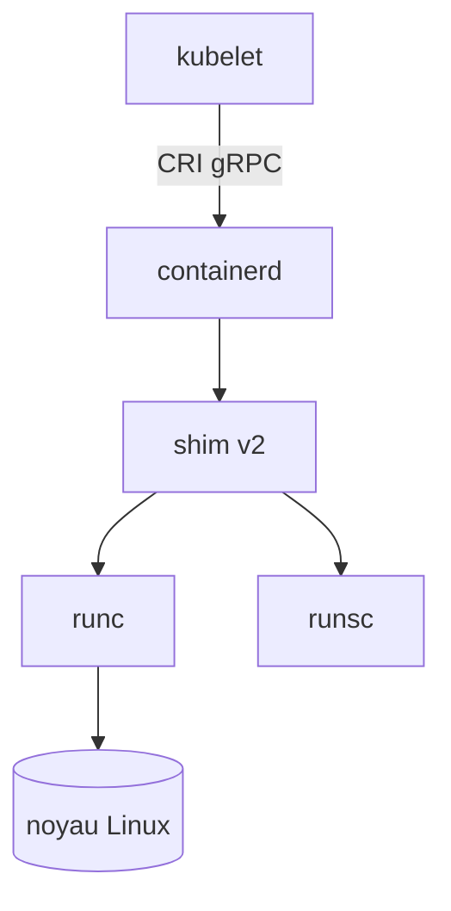

Du kubelet au noyau : CRI, containerd, shim, runtime OCI.

CRI :: API gRPC entre kubelet et le runtime de conteneurs
shim v2 :: processus par pod entre containerd et le runtime

## OCI spec
Le contrat entre runtime et bundle : config.json, cycle de vie, hooks.

## CRI
API gRPC entre kubelet et le runtime de conteneurs.
